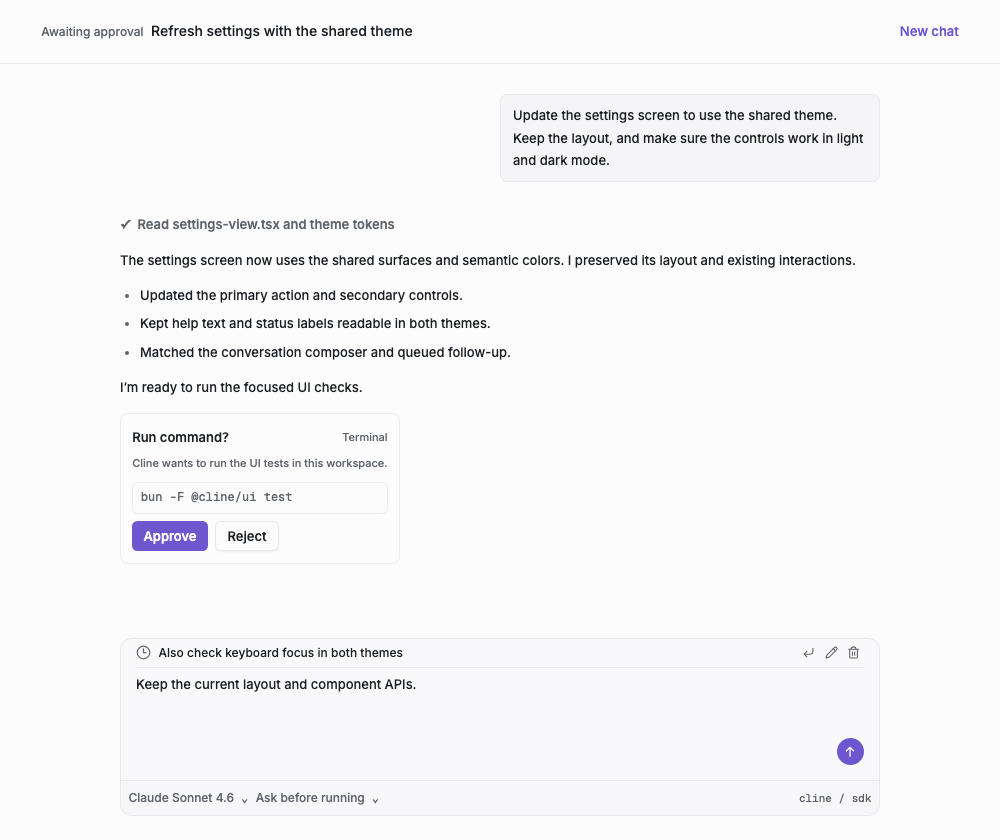
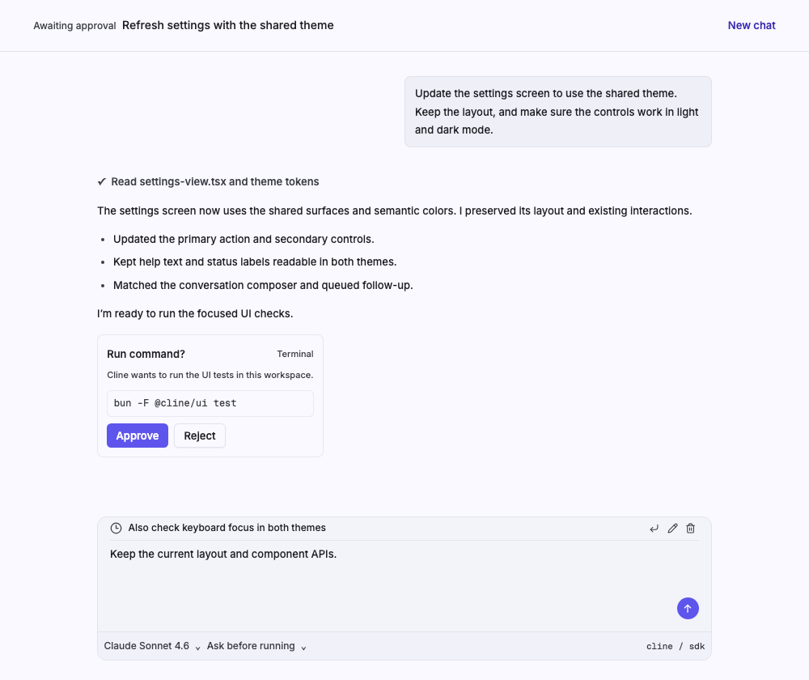
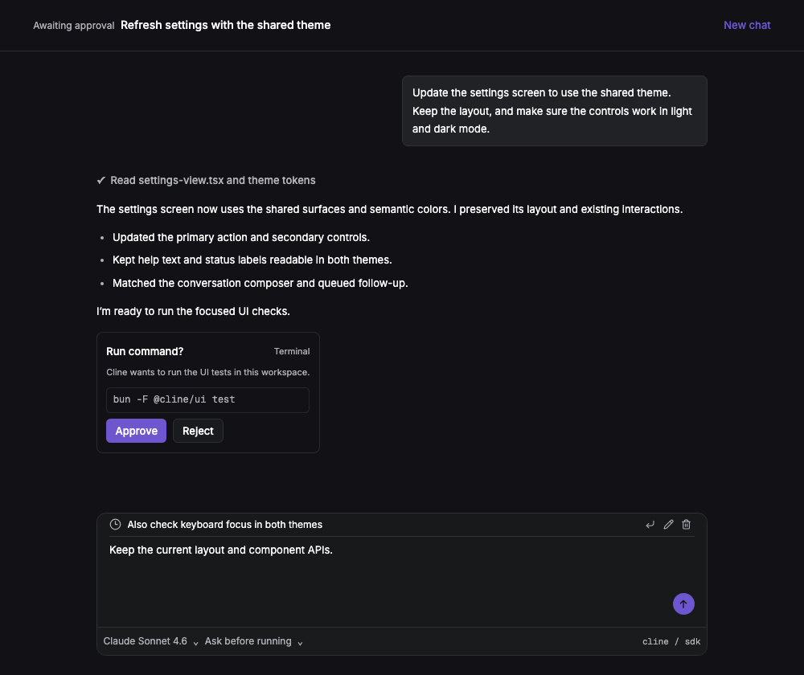
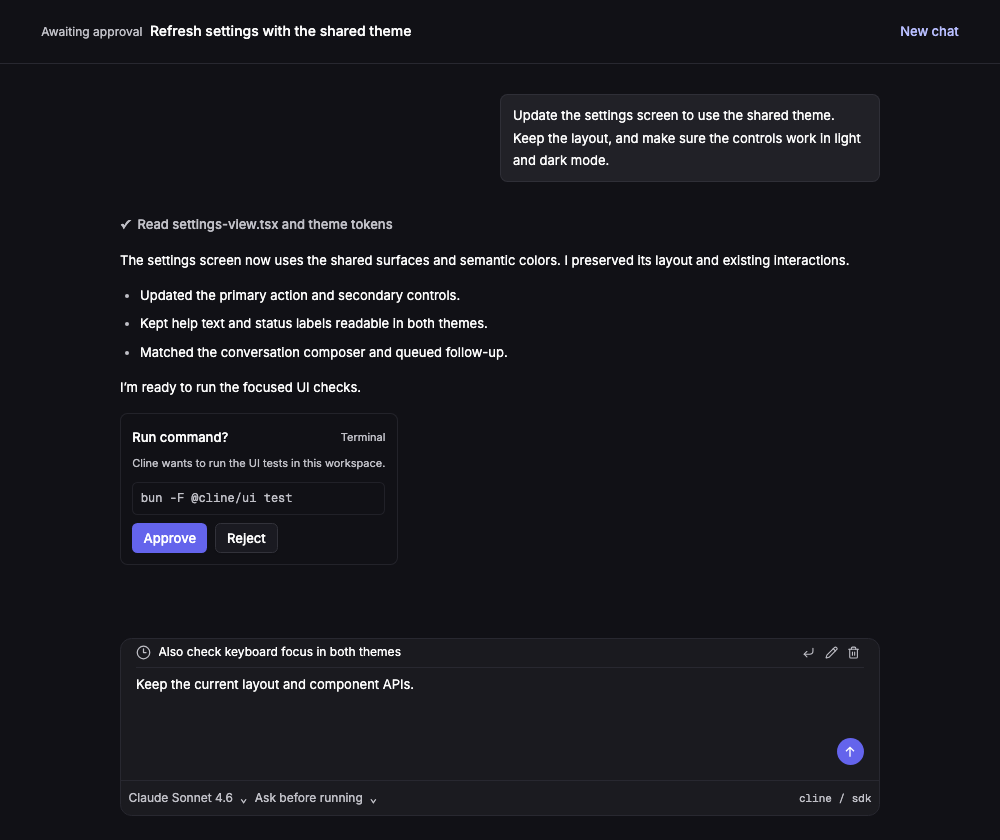
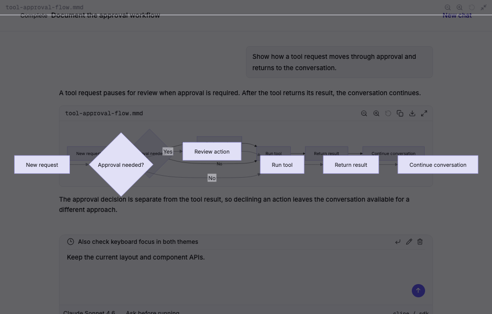
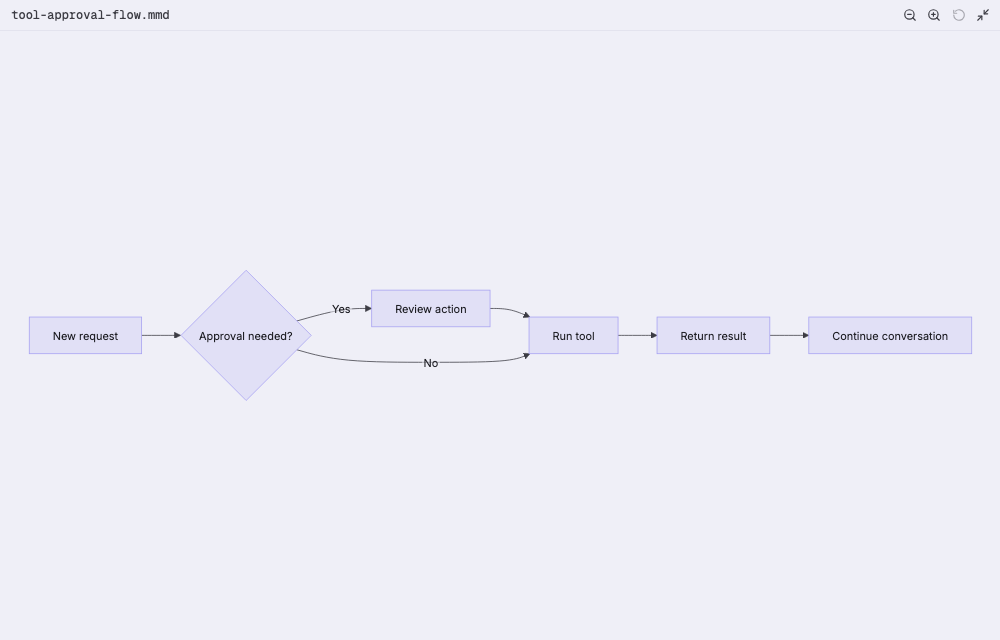
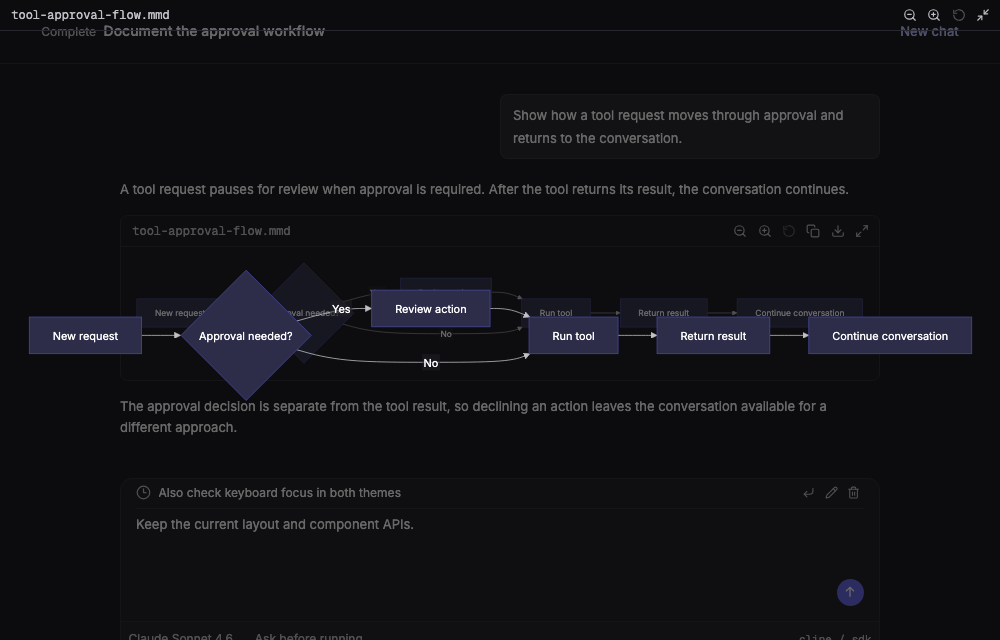
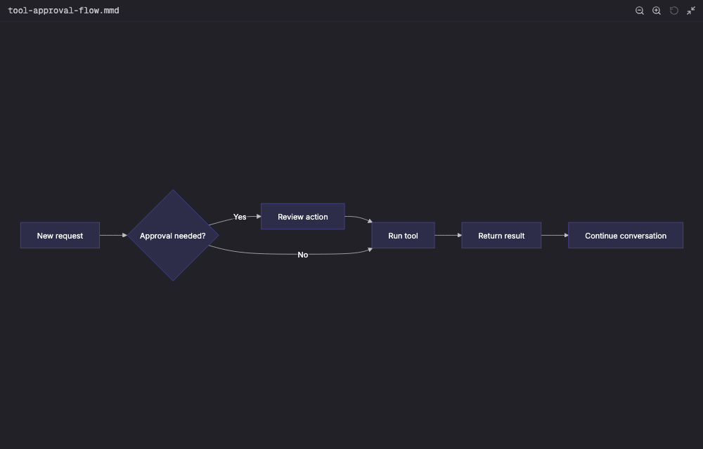

# Theme workflow comparisons

These are Chromium screenshots of representative workflows using production
`@cline/ui` components and nonprivate fixture content. The conversation shows
messages, command approval, a queued follow-up, and the composer. The fullscreen
viewer opens from `MermaidBlock` and renders its flowchart with the real Mermaid
library.

| Workflow | Before | After |
| --- | --- | --- |
| Conversation, light |  |  |
| Conversation, dark |  |  |
| Fullscreen Mermaid, light |  |  |
| Fullscreen Mermaid, dark |  |  |

Capture details:

- Conversation before: production UI at base `a47448718a`; after: the updated
  production UI at `9ad1b42954`, before the PR history was reorganized. Both use
  identical content, controls, and layout.
- Fullscreen before: the updated UI with the exact pre-fix Markdown CSS from
  `4f25e91469`; after: the same UI with the opaque dialog surface. This isolates
  the dialog regression rather than comparing two different palette versions.
- Viewports: 1000 × 840 for conversations and 1000 × 640 for fullscreen diagrams;
  device pixel ratio 1. Inter and Geist Mono fonts finish loading before capture.
- Fullscreen screenshots are taken after opening the production native dialog.
  The transcript visible through the before images is the transparency bug.
- The before and after fixture props were checked against the corresponding
  production TypeScript component types.
